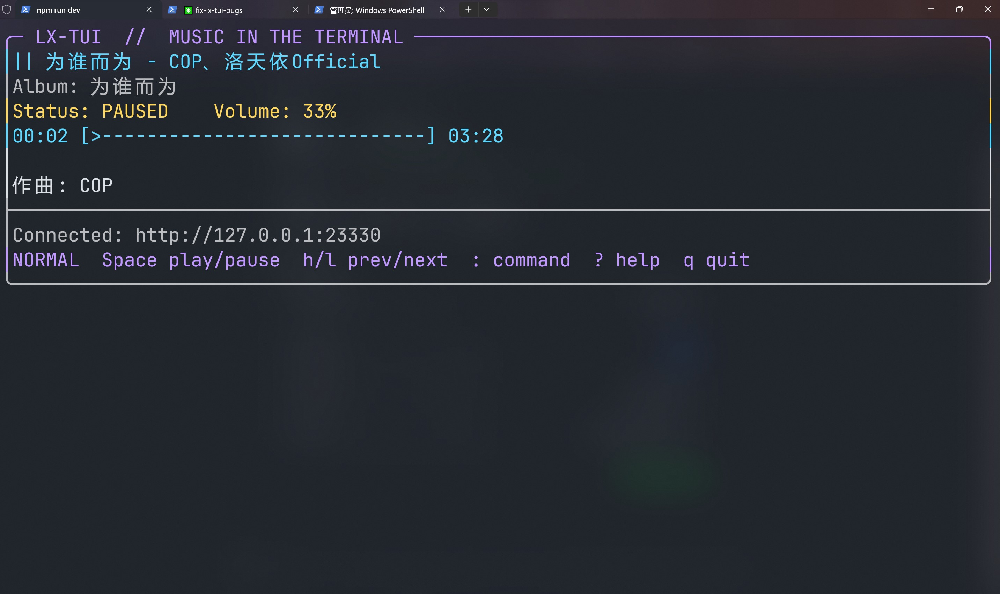

# lx-tui

一个以 Vim 快捷键操作的 LX Music 终端控制器。它不提供音乐源或下载功能，只调用用户本机 LX Music Desktop 开启后的开放 API。

## 界面预览



## 技术栈

- **运行时**：Node.js ≥ 18（ESM，`"type": "module"`）
- **依赖**：零第三方依赖，仅使用 Node 内置模块（`fetch`、`child_process`、`fs/promises`）
- **渲染**：手写 ANSI 转义序列原位刷新（备用屏幕缓冲 + 光标复位，避免 PowerShell 清屏闪烁），256 色主题，支持 `NO_COLOR=1` 关闭颜色
- **布局**：按 Unicode 显示宽度截断文本（CJK 全角字符占 2 列），边框宽度随终端窗口大小自适应（40–140 列）
- **数据**：调用 LX Music Desktop 本地开放 API（`GET /status` 轮询 + 播放控制接口），歌单播放通过 `lxmusic://` Scheme URL 唤起

## 前置条件

1. 启动 LX Music Desktop（v2.7.0+）。
2. 在设置中启用“开放 API 服务”。
3. 确认 `http://127.0.0.1:23330/status` 可访问。

## 启动

```powershell
npm.cmd run dev
```

如 API 地址不同，可指定环境变量：

```powershell
$env:LX_MUSIC_API_URL = 'http://127.0.0.1:23330'
npm.cmd run dev
```

## 已实现按键

| 按键 | 操作 |
| --- | --- |
| `Space` | 播放 / 暂停 |
| `h` / `l` | 上一首 / 下一首 |
| `[` / `]` | 后退 / 前进 5 秒 |
| `-` / `+` | 降低 / 提高音量 |
| `:` | 进入命令模式 |
| `?` | 显示按键帮助 |
| `q` | 退出 |

命令模式支持 `:play`、`:pause`、`:next`、`:prev`、`:now`、`:vol 50`、`:seek 90` 与 `:q`。界面使用原位刷新，避免 PowerShell 的清屏闪烁。

默认会使用 ANSI 颜色区分播放状态、焦点和进度；如果终端主题不兼容，可在 PowerShell 中执行 `$env:NO_COLOR = '1'` 后再启动。

## 侧边栏与播放列表

按 `Space` 后立即按 `e` 可打开或关闭侧边栏；`Ctrl-h`、`Ctrl-l` 分别把焦点切到左侧播放列表和右侧主面板。侧边栏中用 `j`、`k` 选择，并按 `Enter` 让 LX Music 播放所选列表。

在 [config/playlists.json](config/playlists.json) 填入你希望显示的公开歌单：

```json
{
  "playlists": [
    { "name": "My playlist", "source": "kw", "id": "123456" }
  ]
}
```

保存后在程序中输入 `:reload` 重新读取。该功能通过 LX Music 的 Scheme URL 打开并播放歌单；开放 API 本身不提供读取用户本地播放列表或列表歌曲的接口。

后续路线见 [TODO.md](TODO.md)。
